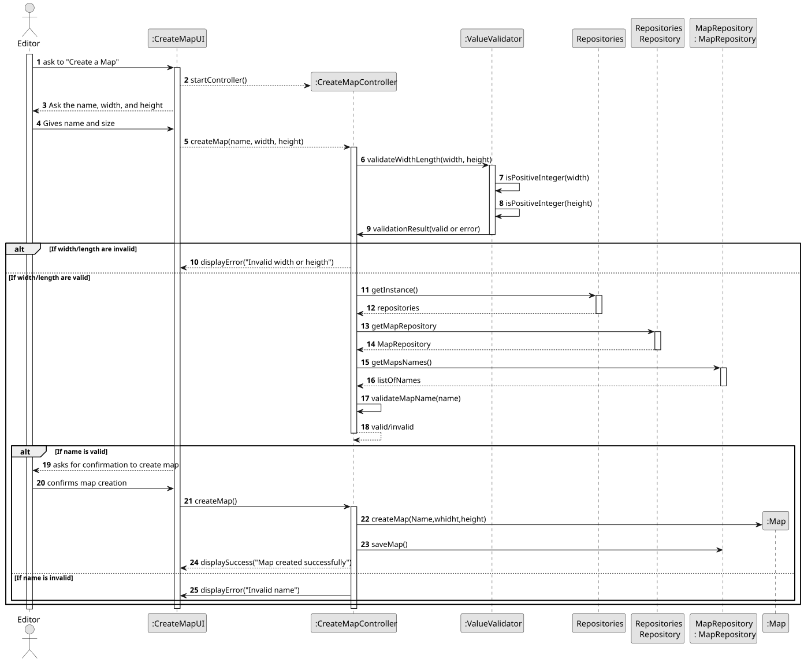
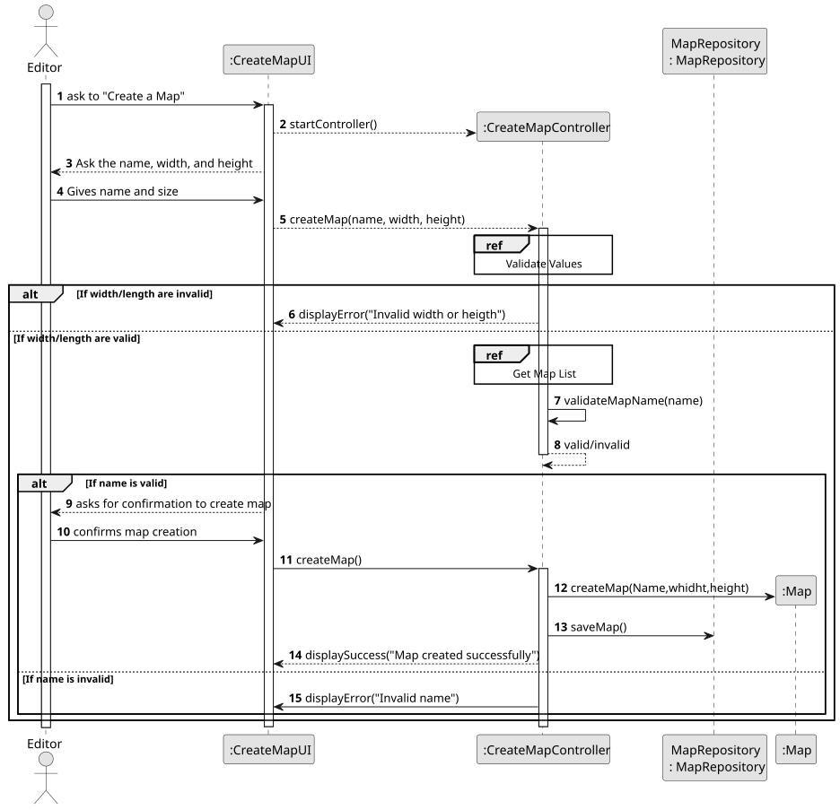
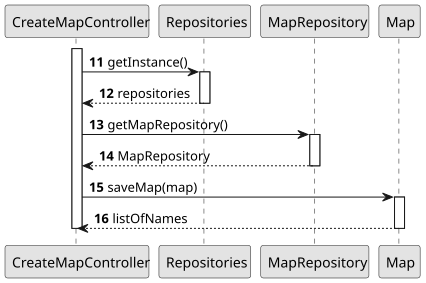
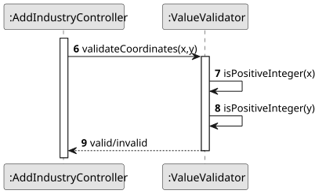
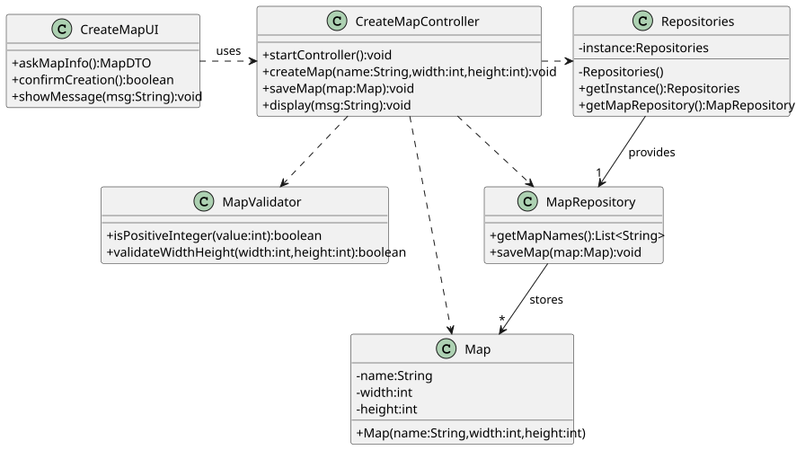

# US001 - Create a Map with a size and a name

## 3. Design

### 3.1. Rationale

| Interaction ID | Question                                                                                | Answer                  | Justification (with patterns)                                                                        |
|:---------------|:----------------------------------------------------------------------------------------|:------------------------|:-----------------------------------------------------------------------------------------------------|
| Step 1         | … interacting with the actor ?                                                          | CreateMapUI             | Pure Fabrication: isolates UI logic in a boundary class (HC, LC).                                    |
|                | … coordinating the use‐case start ?                                                     | CreateMapController     | Controller: orchestrates between UI and domain layers.                                                |
| Step 2         | … vreate map request?                                                                   | CreateMapController     | Information Expert: holds the provided data and delegates to validation and persistence.             |
| Step 3         | … validating width and height ?                                                         | MapValidator            | Information Expert: owns and executes dimension‐check logic (HC).                                    |
| Step 4         | … displaying error on invalid dimensions )?                                             | CreateMapUI             | Pure Fabrication: keeps all user‐feedback responsibilities separate.                                 |
| Step 5         | … obtaining repository instance ?                                                       | Repositories            | Pure Fabrication: acts as singleton façade to supply repositories (LC).                              |
|                | … providing a storage?                                                                  | Repositories            | Creator: knows how to instantiate or supply the correct repository.                                  |
| Step 6         | … retrieving existing map names ?                                        | MapRepository           | Information Expert: manages collection of `Map` objects and returns their names.                     |
| Step 7         | … validating map‐name uniqueness ?                                   | CreateMapController     | Information Expert: coordinates business rule on map names using domain knowledge.                   |
| Step 8         | … displaying error on invalid name )?                                    | CreateMapUI             | Pure Fabrication: handles all error reporting to the user.                                           |
| Step 9         | … asking confirmation before final creation )?                        | CreateMapUI             | Pure Fabrication: centralizes user prompts and confirmations.                                        |

### Systematization ##

According to the taken rationale, the conceptual classes promoted to software classes are:

* Map

Other software classes (i.e. Pure Fabrication) identified:

* CreateMapUI
* CreateMapController
* Repositories
* MapRepository

## 3.2. Sequence Diagram (SD)

### Full Diagram

This diagram shows the full sequence of interactions between the classes involved in the realization of this user story.

### Split Diagrams

The following diagram shows the same sequence of interactions between the classes involved in the realization of this user story, but it is split in partial diagrams to better illustrate the interactions between the classes.

It uses Interaction Occurrence (a.k.a. Interaction Use).

**Get Map list**

**Validate Values**

## 3.3. Class Diagram (CD)

