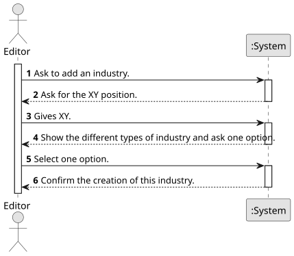

# US002 - Add an industry

## 1. Requirements Engineering

### 1.1. User Story Description

As an Editor, I want to add an industry in a position XY of the selected map.
### 1.2. Customer Specifications and Clarifications 

**From the specifications document:**

> As for industries, there are three different types:

>Primary sector industries- which generate resources, such as mines(e.g., iron, coal, bauxite, or nitrate mines) and farms (vegetables, cereals, wool, coffee, rubber, cattle). The resources generated by these units can, if transported by train in the context of the simulator, be consumed/processed by other types of industries;

> Transforming industries- which transform the resources provided by the Primary Sector Industries into new products. This industry includes bakeries, textiles, automobiles, and steel mills. For example, asteel mill transforms coal and iron ore into steel. The steel produced can then be transported to an automobile factory and used in the production of automobiles.

> Mixed industries- Ports potentially have the capacity, depending on what is defined in the scenario, to import/export any cargo.
> 
**From the client clarifications:**

> **Question:**
As an editor, when adding a new factory, do I need to check for overbuild?
>
> **Answer:** 

### 1.3. Acceptance Criteria

* **AC1:** All required fields must be filled in.
* **AC2:** The task reference must have at least 5 alphanumeric characters.
* **AC3:** When creating a task with an existing reference, the system must reject such operation and the user must be able to modify the typed reference.

### 1.4. Found out Dependencies

* There is a dependency on "US001" - "Create a map" must exist before an industry can be added.

### 1.5 Input and Output Data

**Input Data:**

* Typed data:
    * cordenada X,Y

	
* Selected data:
    * type of industry
    * industry category.
  

**Output Data:**

* (In)Success of the operation

### 1.6. System Sequence Diagram (SSD)

**_Other alternatives might exist._**

### 1.7 Other Relevant Remarks

