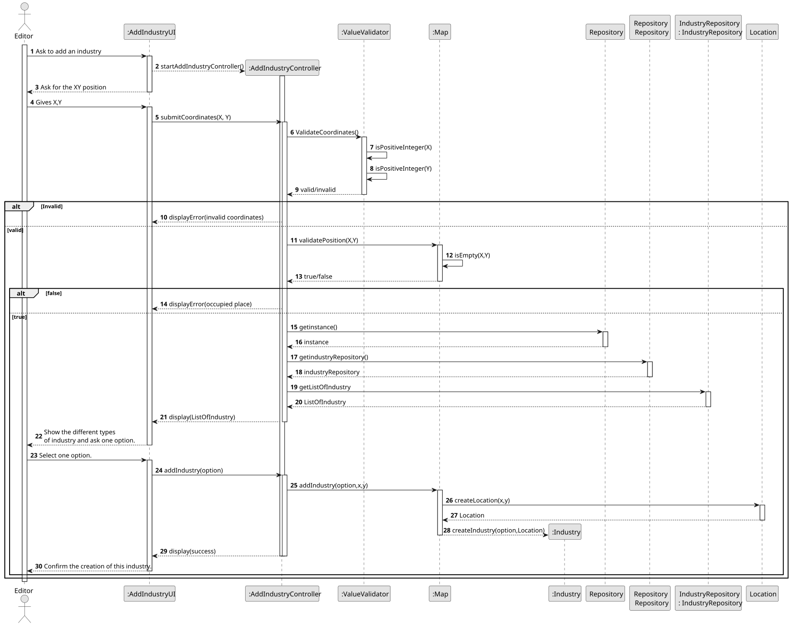
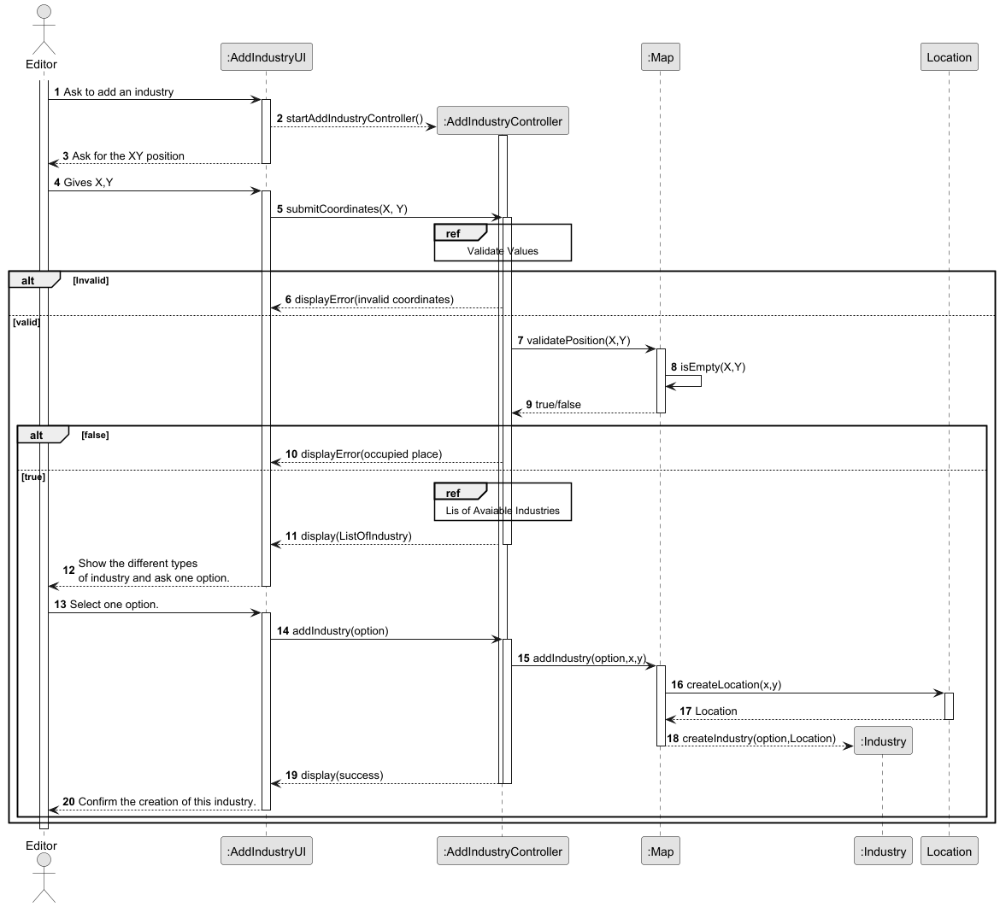
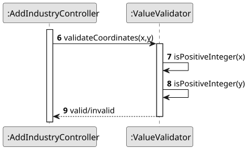
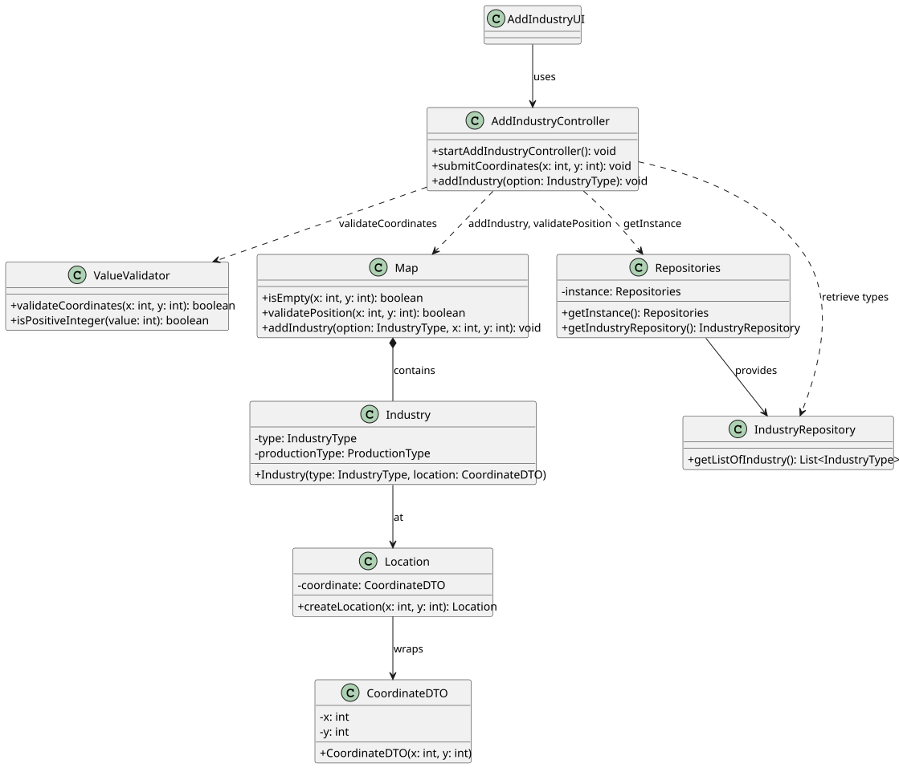

# US006 - Create a Task

## 3. Design

### 3.1. Rationale

| Interaction ID | Question                                                                               | Answer                  | Justification (with patterns)                                                                                           |
|:---------------|:---------------------------------------------------------------------------------------|:------------------------|:------------------------------------------------------------------------------------------------------------------------|
| Step 1         | … interacting with the actor ?                                                         | **AddIndustryUI**       | **Pure Fabrication**: boundary class isolates UI logic from domain/controller (HC, LC).                                 |
|                | … coordinating the use‐case start ?                                                    | **AddIndustryController** | **Controller**: orchestrates between UI and domain layers without containing business logic.                             |
| Step 2         | … asking for the XY position ?                                                         | **AddIndustryUI**       | **Pure Fabrication**: handles user‐interaction step, keeping domain/controller clean.                                    |
| Step 3         | … submitting the coordinates (“submitCoordinates(X,Y)”) to start processing?           | **AddIndustryController** | **Information Expert**: holds submitted data and knows how to delegate validation.                                      |
| Step 4         | … obtaining repository instance ?                                                      | **Repositories**        | **Pure Fabrication**: singleton façade isolates access to concrete repository implementations.                           |
|                | … providing an IndustryRepository ?                                                    | **Repositories**        | **Creator**: factory/facade responsible for instantiating or supplying the correct repository instance.                  |
| Step 5         | … retrieving available industry types ?                                                | **IndustryRepository**  | **Information Expert**: owns the list of industry types and returns it.                                                  |
| Step 6         | … displaying the industry options  to the actor?            | **AddIndustryUI**       | **Pure Fabrication**: manages presentation of choices to the user.                                                       |

### Systematization ##

According to the taken rationale, the conceptual classes promoted to software classes are:

* Industry

Other software classes (i.e. Pure Fabrication) identified:

* AddIndustryUI
* AddIndustryController
* Repositories
* IndustryRepository

## 3.2. Sequence Diagram (SD)

### Full Diagram

This diagram shows the full sequence of interactions between the classes involved in the realization of this user story.

### Split Diagrams

The following diagram shows the same sequence of interactions between the classes involved in the realization of this user story, but it is split in partial diagrams to better illustrate the interactions between the classes.

It uses Interaction Occurrence (a.k.a. Interaction Use).

**Validate Values**

**List of Avaiable Industries**

## 3.3. Class Diagram (CD)

