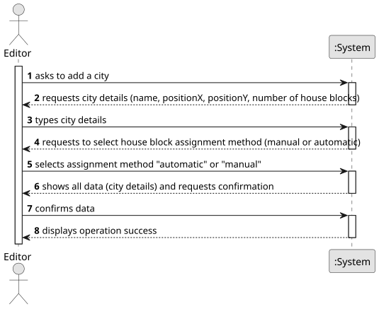

# US003 - Add a City

## 1. Requirements Engineering

### 1.1. User Story Description

As an Editor, I want to add a city in a position XY of the selected
map, with a name and a positive number of house blocks.

### 1.2. Customer Specifications and Clarifications 

**From the specifications document:**

>   Indicate the position XY.
>	City must have a name and a positive number of house blocks. 

**From the client clarifications:**

> **Question:** How does the Editor decide whether house blocks are assigned manually or automatically? Should there be an explicit choice in the interface, or does the system handle this automatically?
>
> **Answer:** Interface is decided by developers.

### 1.3. Acceptance Criteria

* **AC1:** A city name cannot have special characters or digits.
* **AC2:** The house blocks can be assigned manually or automatically (randomly around the city tag position).

### 1.4. Found out Dependencies

* **US01 - Create a Map** → A city can only be added to an existing map.

### 1.5 Input and Output Data

**Input Data:**

* Typed data:
  * City name
  * XY position on the map
  * Number of house blocks

* Selected data:
    * Manual or automatic house block assignment 

**Output Data:**

* (In)Success of the operation

### 1.6. System Sequence Diagram (SSD)

**_Other alternatives might exist._**

### 1.7 Other Relevant Remarks

* N/A.