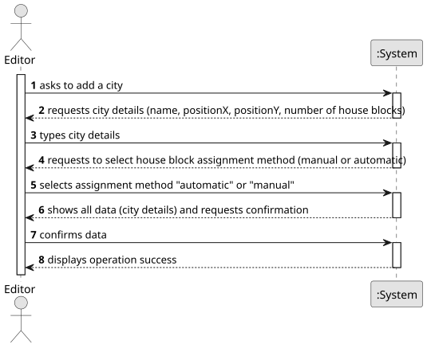

# US006 - Create a Task

## 1. Requirements Engineering

### 1.1. User Story Description

As an Editor, I want to add a city in a position XY of the selected
map, with a name and a positive number of house blocks.

### 1.2. Customer Specifications and Clarifications 

**From the specifications document:**

>   Indicate the position XY.
>	City must have a name and a positive number of house blocks. 

**From the client clarifications:**

> **Question:** question1
>
> **Answer:** answer1.

> **Question:** Monetary data is expressed in any particular currency?
>
> **Answer:** Monetary data (e.g. estimated cost of a task) is indicated in POT (virtual currency internal to the platform).

### 1.3. Acceptance Criteria

* **AC1:** A city name cannot have special characters or digits.
* **AC2:** The house blocks can be assigned manually or automatically (randomly around the city tag position).

### 1.4. Found out Dependencies

* N/A

### 1.5 Input and Output Data

**Input Data:**

* Typed data:
    * a name
    * a designation 
    * an informal description
    * a technical description
    * an estimated duration
    * an estimated cost
	
* Selected data:
    * a task category 

**Output Data:**

* List of existing task categories
* (In)Success of the operation

### 1.6. System Sequence Diagram (SSD)

**_Other alternatives might exist._**

### 1.7 Other Relevant Remarks

* The created task stays in a "not published" state in order to distinguish from "published" tasks.