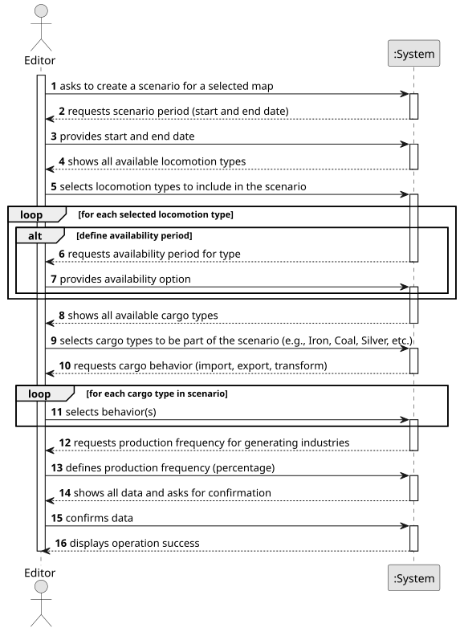

# US004 - Create a Scenario

## 1. Requirements Engineering

### 1.1. User Story Description

As an Editor, I want to create a scenario for a selected map.

### 1.2. Customer Specifications and Clarifications 

**From the specifications document:**

> The Scenario Editor must allow the user to define the restrictions and conditions for using a given map, namely:
• Time Restrictions - the period in which the simulation will take place;
• Technological Restrictions - for example, which locomotives or industries
are available in the scenario;
• Historical Restrictions - historical events that make sense in the scenario
and change the operating conditions of the simulator. For instance,
a war increases the steel demand, and a vaccination campaign
or a schooling program encourages mail and/or passenger traffic. In
this context, the goods that the Ports import and export are also defined.

**From the client clarifications:**

> **Question:** Um cenário pode estar contido em vários mapas? 

> **Answer:** One scenario uses one map; one map can be used in multiple scenarios. 

### 1.3. Acceptance Criteria

* **AC1:** Definition of the behaviour of ports, which cargoes they import/export and/or transform;
* **AC2:** Definition of the available locomotion types (steam, diesel, and/or electric).
* **AC3:** (Re)Definition of the factors that alter the generation (frequency) of generating industries.

### 1.4. Found out Dependencies

* There is a dependency on **US001 - Create a Map**, as a scenario uses a selected map.

### 1.5 Input and Output Data

**Input Data:**

* Typed data:
  * Start date
  * End date
  * Locomotion type 
  * Port cargo behavior
  * Behavior of mixed Industries
  
  
* Selected data:
    * A map

**Output Data:**
* (In)Success of the operation

### 1.6. System Sequence Diagram (SSD)

**_Other alternatives might exist._**

### 1.7 Other Relevant Remarks

* n/a