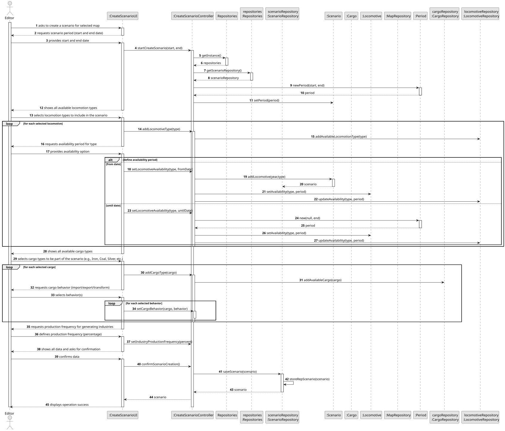
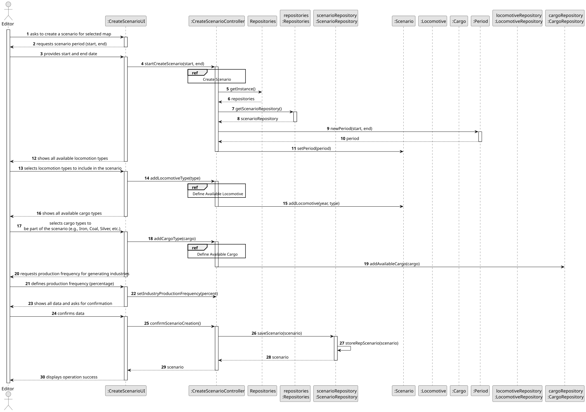
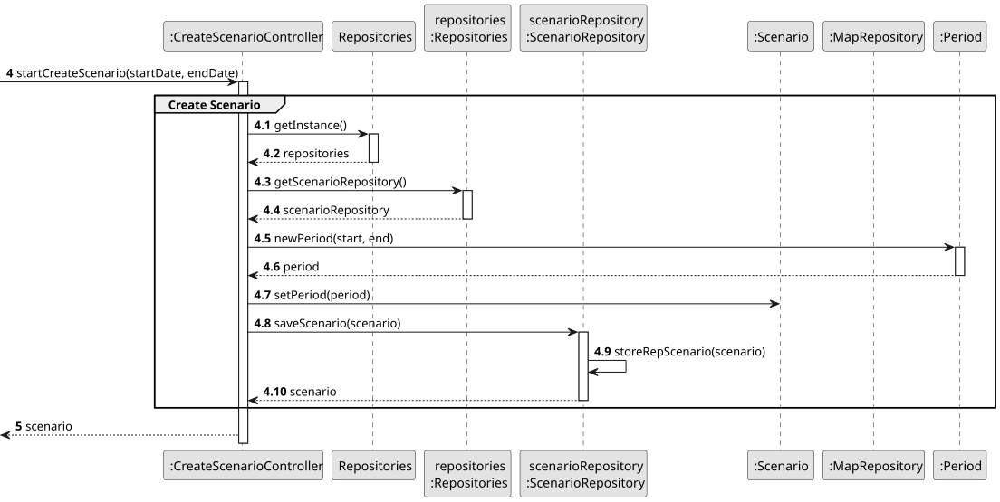
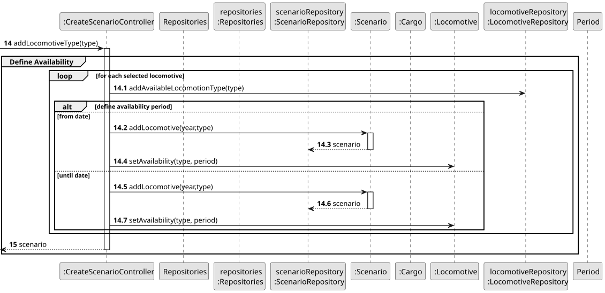
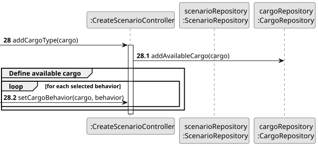
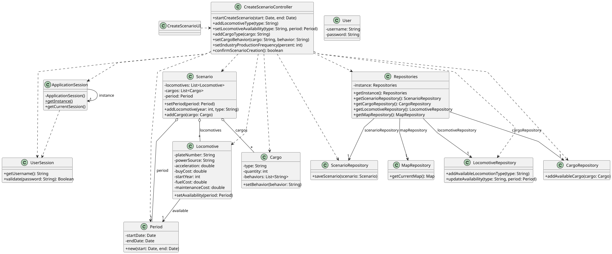

# US004 - Create a Scenario

## 3. Design

### 3.1. Rationale

| Interaction ID | Question: Which class is responsible for...           | Answer                    | Justification (with patterns)                                                                                 |
|:---------------|:------------------------------------------------------|:--------------------------|:--------------------------------------------------------------------------------------------------------------|
| Step 1         | ... interacting with the actor?                       | CreateScenarioUI          | Pure Fabrication: there is no reason to assign this responsibility to any existing class in the Domain Model. |
|                | ... coordinating the US?                              | CreateScenarioController  | Controller: manages the flow and logic of the use case.                                                       |
| Step 2         | ... requesting scenario period (start and end date)?  | CreateScenarioUI          | IE:  is responsible for user interactions.                                                                    |
|                | ... validating the period (start and end dates)?      | Period                    | IE: knows its own data, handles and validates the start and end dates for the scenario.                       |
| **Step 3**     | showing all available locomotive types?               | CreateScenarioUI          | IE:  is responsible for user interactions.                                                                    |
|                | adding each selected locomotive type to the scenario? | CreateScenarioController  | IE: coordinates inclusion in the Scenario.                                                                    |
|                | storing/fetching available types?                     | LocomotiveRepository      | IE: retrieves and persists locomotive‐type data.                                                              |
|                | encapsulating availability logic on each locomotive?  | Locomotive                | IE: applies its own availability period.                                                                      |
| **Step 4**     | showing all available cargo types?                    | CreateScenarioUI          | IE:  is responsible for user interactions.                                                                    |
|                | adding each selected cargo type to the scenario?      | CreateScenarioController  | IE: coordinates inclusion in the Scenario.                                                                    |
|                | storing/fetching available cargo?                     | CargoRepository           | IE: retrieves and persists cargo‐type data.                                                                   |
|                | encapsulating cargo-behavior logic?                   | Cargo                     | IE: applies its own behavior rules.                                                                           |
| **Step 5**     | requesting production frequency?                      | CreateScenarioUI          | IE: a is responsible for user interactions.                                                                   |
|                | storing/validating the percentage in the scenario?    | CreateScenarioController  | IE: coordinates setting of production frequency on Scenario.                                                  |
| **Step 6**     | confirming all data and invoking persistence?         | CreateScenarioUI          | IE:  is responsible for user interactions.                                                                    |
|                | persisting the new Scenario?                          | ScenarioRepository        | Creator: stores the new scenario with all relevant information.                                               |
| **Step 7**     | informing operation success?                          | CreateScenarioUI          | IE:  is responsible for user interactions.                                                                    |

### Systematization ##

According to the taken rationale, the conceptual classes promoted to software classes are:

* Scenario
* Map
* Period
* Cargo
* Locomotive

Other software classes (i.e. Pure Fabrication) identified:

* CreateScenarioUI
* CreateScenarioController
* ScenarioRepository
* MapRepository
* CargoRepository
* LocomotiveRepository

## 3.2. Sequence Diagram (SD)

### Full Diagram

This diagram shows the full sequence of interactions between the classes involved in the realization of this user story.

### Split Diagrams

The following diagram shows the same sequence of interactions between the classes involved in the realization of this user story, but it is split in partial diagrams to better illustrate the interactions between the classes.

It uses Interaction Occurrence (a.k.a. Interaction Use).

**Create Scenario Partial SD**

**Define Available Locomotive types**

**Define Available Cargo types**

## 3.3. Class Diagram (CD)

