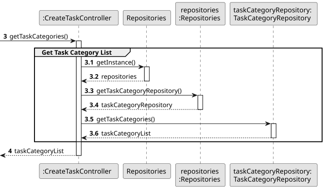

# US004 - Create a Scenario

## 3. Design

### 3.1. Rationale

| Interaction ID | Question: Which class is responsible for...                    | Answer                   | Justification (with patterns)                                                                                              |
|:---------------|:---------------------------------------------------------------|:-------------------------|:---------------------------------------------------------------------------------------------------------------------------|
| Step 1         | ... interacting with the actor?                                | CreateScenarioUI         | Pure Fabrication: there is no reason to assign this responsibility to any existing class in the Domain Model.             |
|                | ... coordinating the US?                                       | CreateScenarioController | Controller: manages the flow and logic of the use case.                                                                   |
|                | ... knowing the user using the system?                         | UserSession              | IE: represents the user session throughout the interaction.                                                               |
|                |                                                                | ApplicationSession       | IE: manages the session and provides access to the current UserSession.                                                    |
| Step 2         | ... requesting the map to create the scenario?                 | CreateScenarioController | IE: asks for the map selection to proceed.                                                                                  |
|                | ... fetching all available maps for selection?                 | MapRepository            | IE: retrieves map information from the data store.                                                                         |
| Step 3         | ... storing the selected map?                                  | CreateScenarioController | IE: temporarily holds the map choice for the scenario.                                                                     |
| Step 4         | ... requesting temporal information (start and end dates)?     | CreateScenarioController | IE: asks for temporal details for the scenario.                                                                            |
| Step 5         | ... validating the period (start and end dates)?               | Period                   | IE: handles and validates the start and end dates for the scenario.                                                         |
| Step 6         | ... asking for cargo type?                                     | CreateScenarioController | IE: asks the user to specify the cargo type for the scenario.                                                              |
|                | ... selecting the cargo type?                                  | CargoType                | IE: defines the different types of cargo for the scenario.                                                                  |
| Step 7         | ... asking for locomotion type?                                | CreateScenarioController | IE: asks the user to specify the locomotion type for the scenario.                                                          |
|                | ... selecting the locomotion type?                             | LocomotionType           | IE: defines the different types of locomotives for the scenario.                                                            |
| Step 8         | ... creating the new scenario with all data?                   | ScenarioRepository       | Creator: stores the new scenario with all relevant information, including map, period, cargo type, and locomotion type.     |
|                | ... saving the scenario to the database?                        | ScenarioRepository       | IE: saves the scenario data permanently.                                                                                    |
| Step 9         | ... informing the user of success?                             | CreateScenarioUI         | IE: informs the user of the successful creation of the scenario.                                                            |

### Systematization ##

According to the taken rationale, the conceptual classes promoted to software classes are:

* Scenario
* Map
* Period
* CargoType
* LocomotionType

Other software classes (i.e. Pure Fabrication) identified:

* CreateScenarioUI
* CreateScenarioController
* ScenarioRepository
* MapRepository
* ApplicationSession
* UserSession

## 3.2. Sequence Diagram (SD)

### Full Diagram

This diagram shows the full sequence of interactions between the classes involved in the realization of this user story.

### Split Diagrams

The following diagram shows the same sequence of interactions between the classes involved in the realization of this user story, but it is split in partial diagrams to better illustrate the interactions between the classes.

It uses Interaction Occurrence (a.k.a. Interaction Use).

**Get Task Category List Partial SD**

**Get Task Category Object**

**Get Employee**

**Create Task**

## 3.3. Class Diagram (CD)

