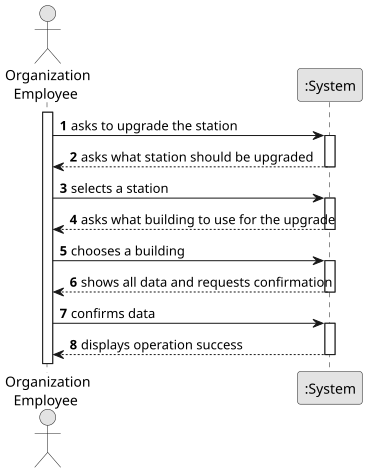

# US06 - Upgrade a station

## 1. Requirements Engineering

### 1.1. User Story Description

As a Player, I want to upgrade a station with a building 

### 1.2. Customer Specifications and Clarifications 

**From the specifications document:**

>	After building a station, you can upgrade it with other buildings that can increase the station's performance, improve train operation, facilitate train manoeuvrers and increase the lifespan of cargo stored at the station 
>	When observing a station, besides the existing buildings, it should also display the cargo awaiting collection and the cargo that requires delivery.

**From the client clarifications:**

> **Question:** Which is the unit of measurement used to estimate duration?
>
> **Answer:** Duration is estimated in days.

> **Question:** Monetary data is expressed in any particular currency?
>
> **Answer:** Monetary data (e.g. estimated cost of a task) is indicated in POT (virtual currency internal to the platform).

### 1.3. Acceptance Criteria

N.A.

### 1.4. Found out Dependencies

* There needs to be a station so you can upgrade it with another building
* 

### 1.5 Input and Output Data

**Input Data:**

* Typed data:
    * a reference
    * a designation 
    * an informal description
    * a technical description
    * an estimated duration
    * an estimated cost
	
* Selected data:
    * a task category 

**Output Data:**

* List of existing task categories
* (In)Success of the operation

### 1.6. System Sequence Diagram (SSD)

**_Other alternatives might exist._**

### 1.7 Other Relevant Remarks

* The created task stays in a "not published" state in order to distinguish from "published" tasks.