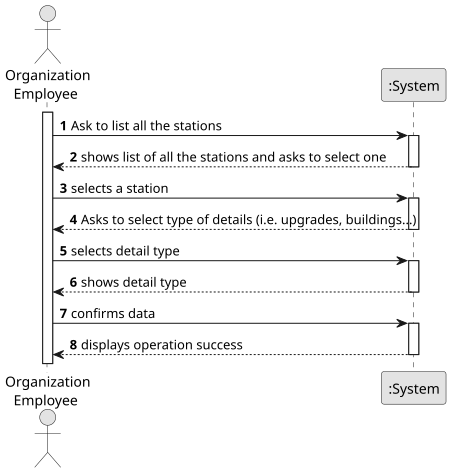

# US007 - List all the Stations

## 1. Requirements Engineering

### 1.1. User Story Description

As a Player, I want to list all the stations to select one to see its details, including the existing building and the demand/supply cargoes.

### 1.2. Customer Specifications and Clarifications 

**From the specifications document:**

>	When viewing a station, in addition to the buildings present, the cargo that is ready for collection and the cargo that needs to be delivered should also be displayed. 
 

**From the client clarifications:**

> **Question:** Regarding trains with different types of fuels (steam, diesel and electricity) that work on certain types of railroad. Diesel and steam trains can work on any type of railroads, while electric trains should work exclusively on electrified railroads? If not, then which types of trains work on which types of railroads?
> 
> **Answer:** yes, Diesel and steam trains can work on any type of railroads, while electric trains should work exclusively on electrified railroads.

> **Question:** Will this US be implemented as an automatic validation when the player establishes a train route between two stations? For instance: the player tries to add an electric train on a route that doesn't have electrified railroads, the game should detect that and deny the player's action? If this is incorrect, then this US is a manual verification the player can select?
>
> **Answer:** There is an important difference between route and path, a route is ordered list of stations that should be visited and where the cargos should be dropped and loaded, the path is the sequence of lines to be used to complete a route. So, a route can be satisfied with multiple different paths. If a route is assigned to a train and there is no possible path to accomplish the route, then a message should raised.

> **Question:** When the user selects an existing station, does it automatically show all the associated info to that station or the user selects the station then has to select the required option ? eg: 'show details'.
> 
> **Answer:** That's a matter of UX/UI, each team can decide what works best.

### 1.3. Acceptance Criteria

* **AC:** N/A

### 1.4. Found out Dependencies

* There is a dependency on "US005 - Build a station" as there must be at least one station already built to be able to list it.

### 1.5 Input and Output Data

**Input Data:**

* Typed data:
  
	
* Selected data:
    * station

**Output Data:**
* list of stations
* station details
* (In)Success of the operation

### 1.6. System Sequence Diagram (SSD)

**_Other alternatives might exist._**

### 1.7 Other Relevant Remarks

* N/A