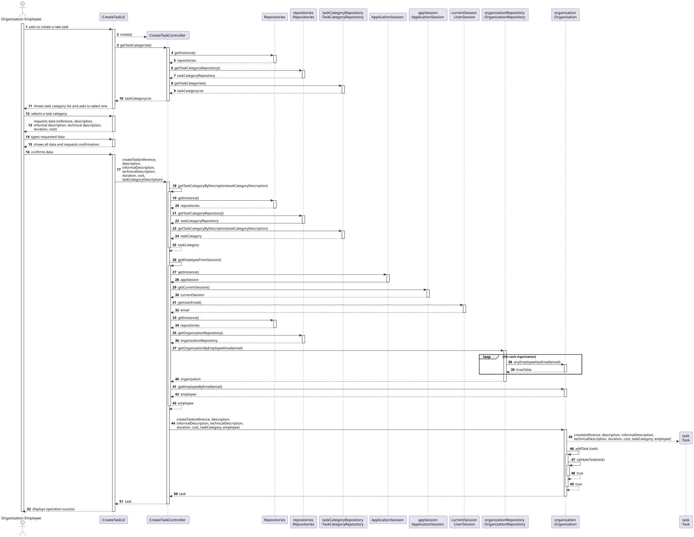
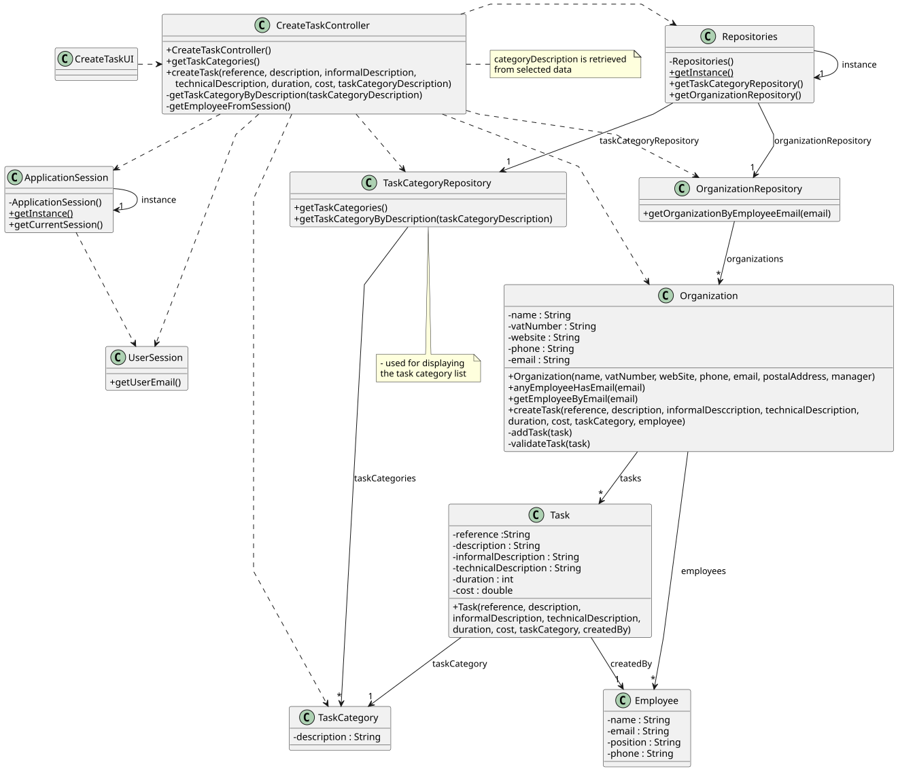

# US007- List all the Stations by Details

## 3. Design

### 3.1. Rationale

| Interaction ID | Question: Which class is responsible for...  | Answer                         | Justification (with patterns)                                        |
|:---------------|:---------------------------------------------|:-------------------------------|:---------------------------------------------------------------------|
| Step 1         | ... interacting with the actor?              | ListStationsUI                 | Pure Fabrication: Dedicated UI class for station listing operations. |
|                | ... coordinating the US?                     | ListStationsController         | Controller.                                                          |
|                | ... knowing the current player?              | PlayerSession                  | IE: Maintains authenticated player context.                          |
|                |                                              |                                |                                                                      |
|                |                                              |                                |                                                                      |
| Step 2         | ... knowing all existing stations to show?   | StationRepository              | IE: is responsible for storing all station data.                     |
|                |                                              |                                |                                                                      |
| Step 3         | ... displaying the station list?             | StationListUI                  | IE: Handles all station display logic                                |
| Step 4         | ... handling station selection?              | StationController              | Controller: Mediates between UI and domain logic.                    |
| Step 5         | ... fetching details of selected station?    | StationRepository              | IE: is responsible for storing all station data.                     |
| Step 6         | ... showing station details?                 | StationListUI                  | IE: is responsible for displaying information to player              |              

### Systematization ##

According to the taken rationale, the conceptual classes promoted to software classes are: 

* Station
* StationUpgrade
* Cargo
* Player

Other software classes (i.e. Pure Fabrication) identified: 

* StationListUI
* StationController
* StationRepository
* PlayerSession

## 3.2. Sequence Diagram (SD)

### Full Diagram

This diagram shows the full sequence of interactions between the classes involved in the realization of this user story.

### Split Diagrams

The following diagram shows the same sequence of interactions between the classes involved in the realization of this user story, but it is split in partial diagrams to better illustrate the interactions between the classes.

It uses Interaction Occurrence (a.k.a. Interaction Use).

**Get Task Category List Partial SD**

**Get Task Category Object**

**Get Employee**

**Create Task**

## 3.3. Class Diagram (CD)

