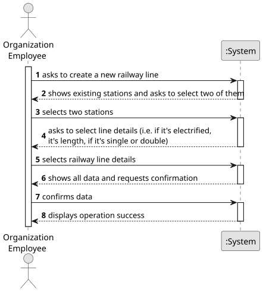

# US008 - Build Railway Line

## 1. Requirements Engineering

### 1.1. User Story Description

As a Player, I want to build a railway line between two stations.

### 1.2. Customer Specifications and Clarifications 

**From the specifications document:**

>   Railway lines allow the connection between two stations. It is not intended to make a detailed graphical edition of the route, but only a topological representation of the connection between two stations.

>   A line has a certain length, can be single or double, and can be electrified (or not).

**From the client clarifications:**

> **Question:** 
>
> **Answer:** 

> **Question:**
>
> **Answer:**

### 1.3. Acceptance Criteria

* **AC1:**  The player should choose at least two stations from a list of registered stations.
* **AC2:** 
* **AC3:**

### 1.4. Found out Dependencies

* There is a dependency on "US005 - Build Station" as there must be at least two stations already built for one railway to be built.

### 1.5 Input and Output Data

**Input Data:**

* Typed data:
    * a reference
    * a designation 
    * an informal description
    * a technical description
    * an estimated duration
    * an estimated cost
	
* Selected data:
    * a task category 

**Output Data:**

* topological representation of the railway line
* (In)Success of the operation

### 1.6. System Sequence Diagram (SSD)

**_Other alternatives might exist._**

### 1.7 Other Relevant Remarks

* The created task stays in a "not published" state in order to distinguish from "published" tasks.