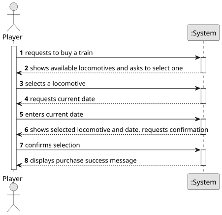

# US009 - Buy a Train

## 1. Requirements Engineering

### 1.1. User Story Description

As a Player, I want to buy a train.

### 1.2. Customer Specifications and Clarifications 

**From the specifications document:**

>	Trains are composed of locomotives and carriages. 

>	The locomotives are characterized by several technical aspects, such as power, acceleration, top speed, start year of operation, and acquisition price. 

>	Note that electric locomotives require electrified lines.

>	In the simulator, the player/user acquires trains within the available budget and can put the train into service on a specific route.

**From the client clarifications:**

> **Question:** Which is the unit of measurement used to estimate duration?
>
> **Answer:** Duration is estimated in days.

### 1.3. Acceptance Criteria

* **AC1:** The player should choose the locomotive from a list of available locomotives for the scenario as well as a current date.

### 1.4. Found out Dependencies

* There is a dependency on "US004 - Create a Scenario" as the scenario determines what locomotives/trains are available.

### 1.5 Input and Output Data

**Input Data:**

* Typed data:
    * a reference
    * a designation 
    * an informal description
    * a technical description
    * an estimated duration
    * an estimated cost
	
* Selected data:
    * a task category 

**Output Data:**

* List of existing task categories
* (In)Success of the operation

### 1.6. System Sequence Diagram (SSD)

**_Other alternatives might exist._**

### 1.7 Other Relevant Remarks

* The created task stays in a "not published" state in order to distinguish from "published" tasks.