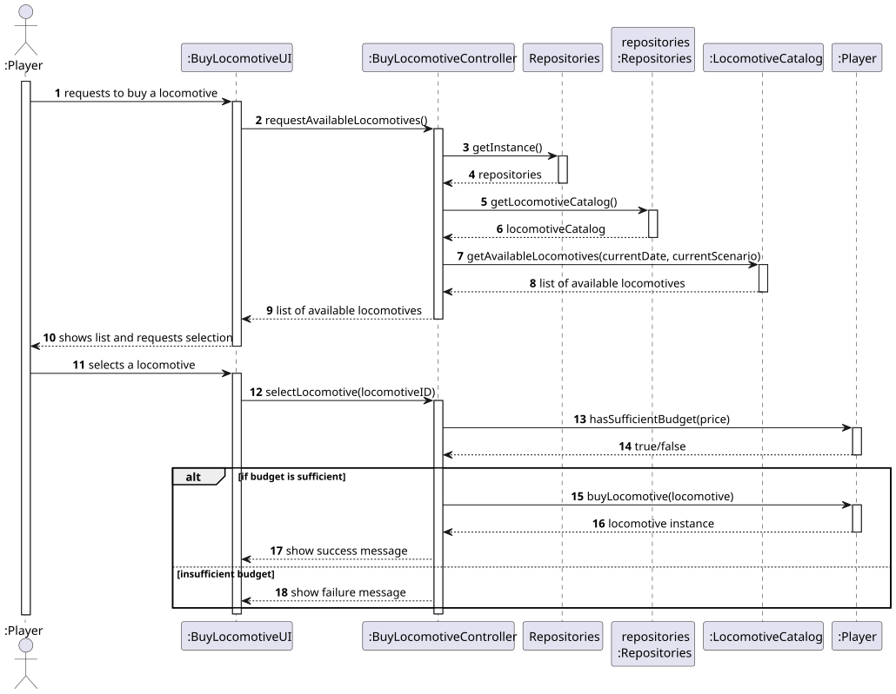
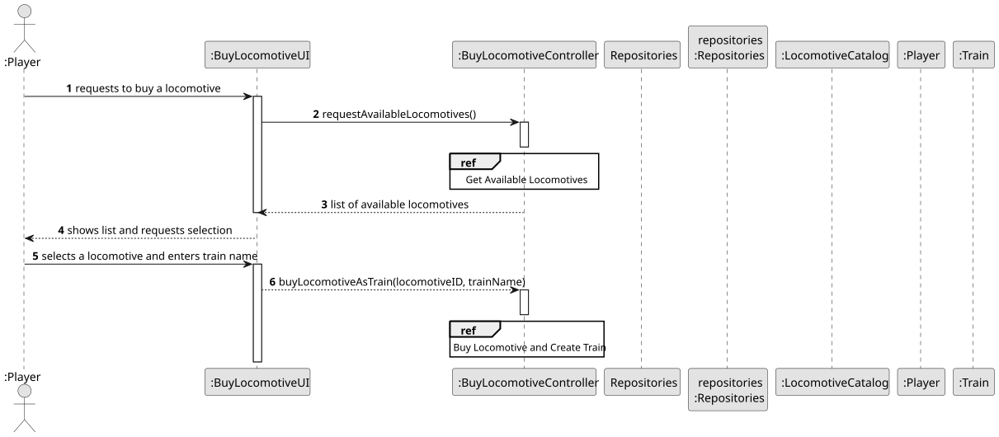
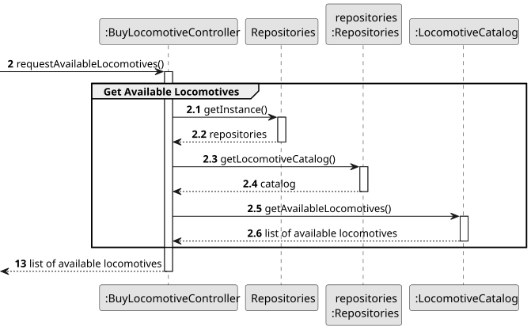
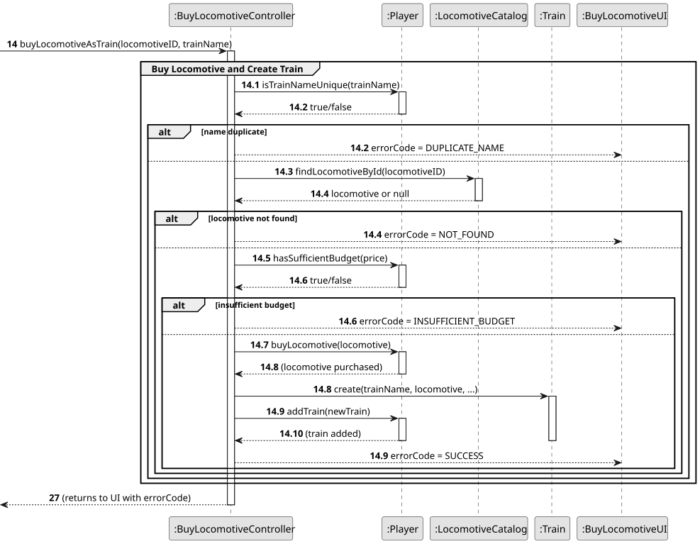
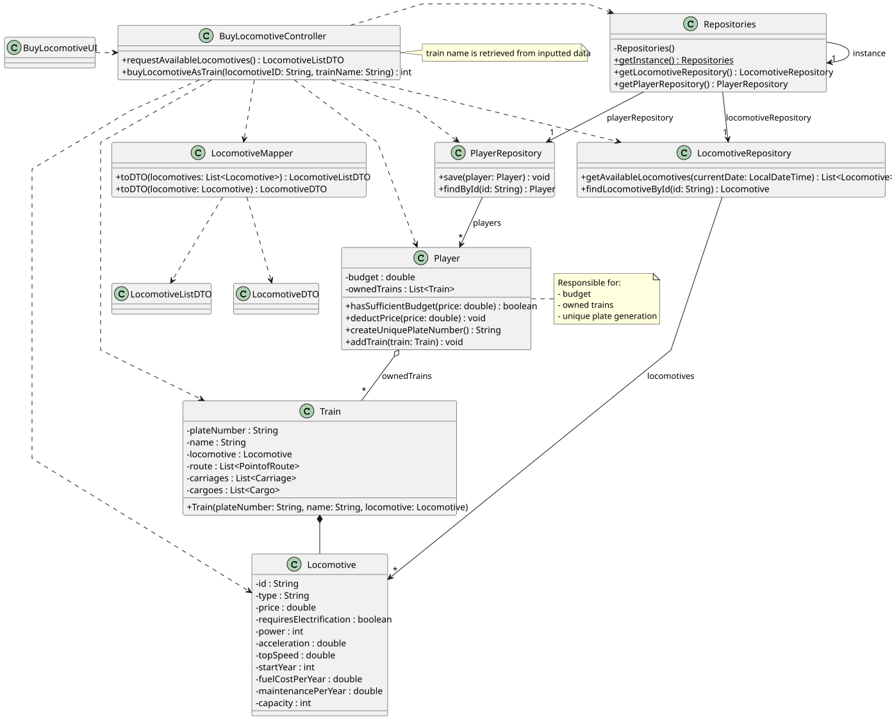

# US009 - Buy a Locomotive

## 3. Design

### 3.1. Rationale

| Interaction ID | Question: Which class is responsible for...                         | Answer                   | Justification (with patterns)                                                                 |
|----------------|---------------------------------------------------------------------|--------------------------|----------------------------------------------------------------------------------------------|
| Step 1         | ... interacting with the actor?                                     | :BuyLocomotiveUI         | Pure Fabrication: dedicated to UI responsibilities, not in the domain model.                |
|                | ... coordinating the user story?                                    | :BuyLocomotiveController | Controller: handles the workflow of the use case.                                           |
|                | ... providing list of locomotives available in current scenario?    | :LocomotiveCatalog       | Information Expert: knows about locomotives, availability conditions (date, scenario).      |
| Step 2         | ... retrieving player's current budget?                             | :Player                  | Information Expert: knows its own budget.                                                   |
| Step 3         | ... checking if purchase can be made (enough funds)?                | :BuyLocomotiveController | Controller: handles decision logic for allowing the purchase.                              |
| Step 4         | ... assigning ownership of the new locomotive?                      | :Player                  | Creator: owns locomotives, should create and hold new instance.                            |
| Step 5         | ... giving a unique ID to each locomotive instance?                 | :LocomotiveCatalog       | Information Expert: maintains locomotive inventory, can issue unique IDs.                   |
| Step 6         | ... informing operation success/failure to the player?              | :BuyLocomotiveUI         | Information Expert: communicates results to the user.                                       |
| Step 7         | ... persisting the updated player and train ownership data?         | :PlayerRepository        | Pure Fabrication & Information Expert: handles persistence of Player domain object.         |

### Systematization ##

According to the rationale, the conceptual classes promoted to software classes are:

* Locomotive
* Player
* Scenario

Other software classes (Pure Fabrication) identified:

* :BuyLocomotiveUI
* :BuyLocomotiveController
* :PlayerRepository
* :LocomotiveCatalog

## 3.2. Sequence Diagram (SD)

### Full Diagram

This diagram shows the full sequence of interactions between the classes involved in the realization of this user story.

### Split Diagrams

The following diagram shows the same sequence of interactions between the classes involved in the realization of this user story, but it is split in partial diagrams to better illustrate the interactions between the classes.

It uses Interaction Occurrence (a.k.a. Interaction Use).

**Get Available Locomotives**

**Buy Locomotive and Create Train**

## 3.3. Class Diagram (CD)

