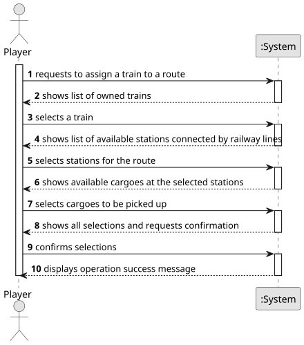

# US010 - Assign a Train to a Route

## 1. Requirements Engineering

### 1.1. User Story Description

As a Player, I want to assign a selected train to a route with a valid station and the respective list of cargoes to be picked up.

### 1.2. Customer Specifications and Clarifications 

**From the specifications document:**

> A route is a list of stations where the train passes, along which it loads (carriages) cargo at each station.

> Railway Lines allow the connection of two stations. 

> The carriages are distinguished by the type of cargo they  can transport (e.g., passengers, mail, coal, iron ore, steel, cars) and, in the context of the simulator, they have no acquisition cost.

**From the client clarifications:**

> **Question:** Can multiple cargo types be assigned to the same train?
>
> **Answer:** Yes.

> **Question:** Does a route have a limit of stations that can be assigned?
>
> **Answer:** No.

> **Question:** A route is a list of stations where the train passes. If there is many stations but no railway lines, are we able to create a route?
>
> **Answer:** If there is no path between any pair of consecutive points of the route, the player should be warned, then the player can opt between cancel/proceed.

### 1.3. Acceptance Criteria

NA

### 1.4. Found out Dependencies

* There is a dependency on **US001 - Create a Map**, as a scenario can only be created for an existing map previously selected.
* There is a dependency on **US05 - Build a station**, as there must be stations to create a route.
* There is a dependency on **US08 - Build a railway line between two stations**, as there must be railway lines connecting the stations on the route.
* There is a dependency on **US09 - Buy a locomotive**, as there must be at least one train owned by the player.

### 1.5 Input and Output Data

**Input Data:**

* Typed data:
    * none
	
* Selected data:
    * a train (from owned trains)
    * a route
    * a cargo to be picked up

**Output Data:**

* List of available trains
* List of available stations connected by railway lines
* List of available cargoes at the stations
* (In)Success of the operation

### 1.6. System Sequence Diagram (SSD)

**_Other alternatives might exist._**

### 1.7 Other Relevant Remarks

NA