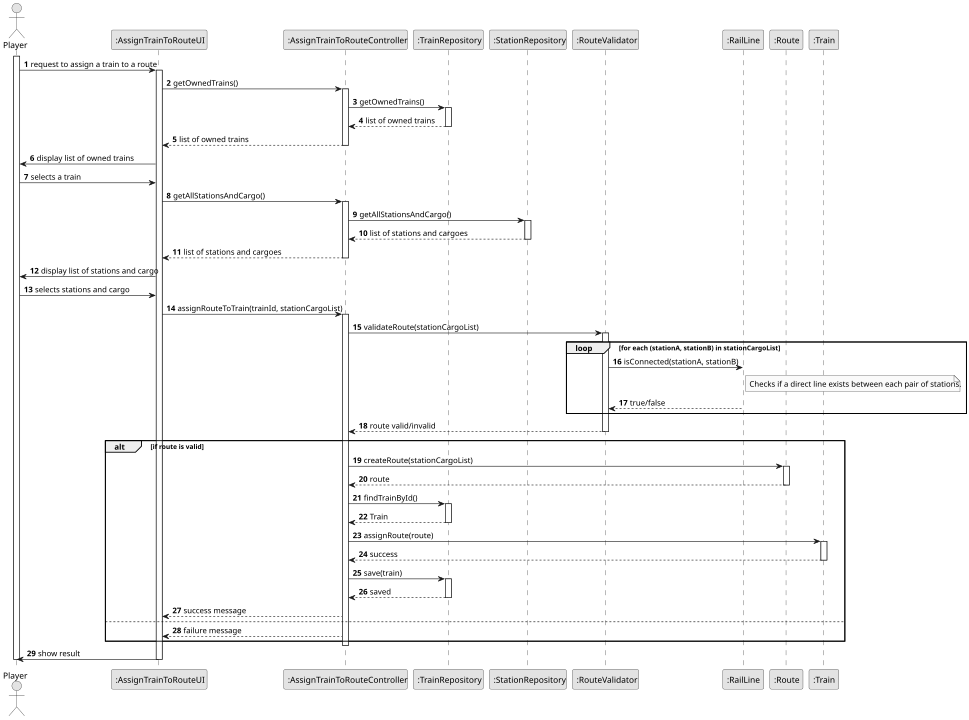
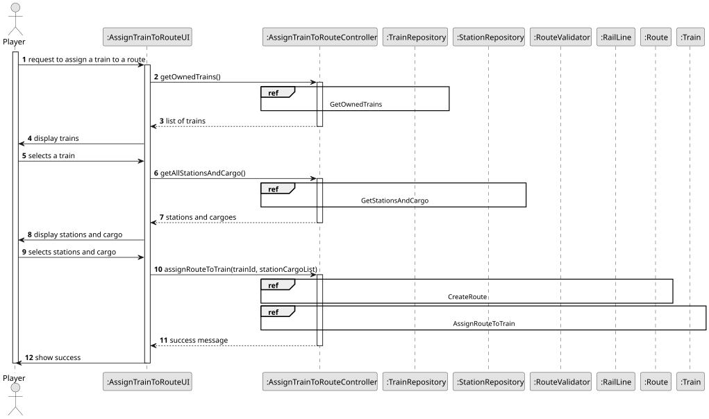
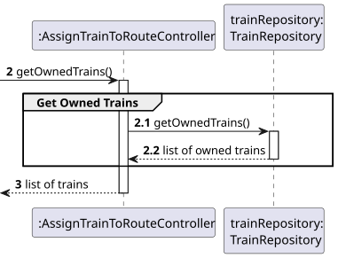
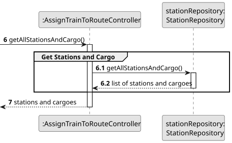
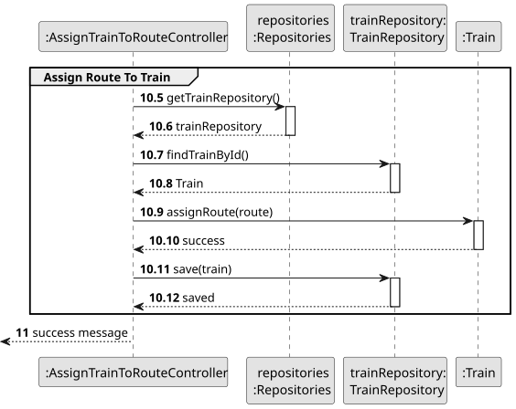
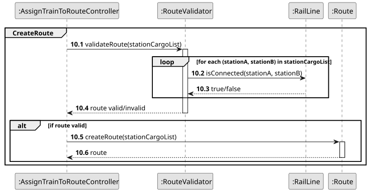
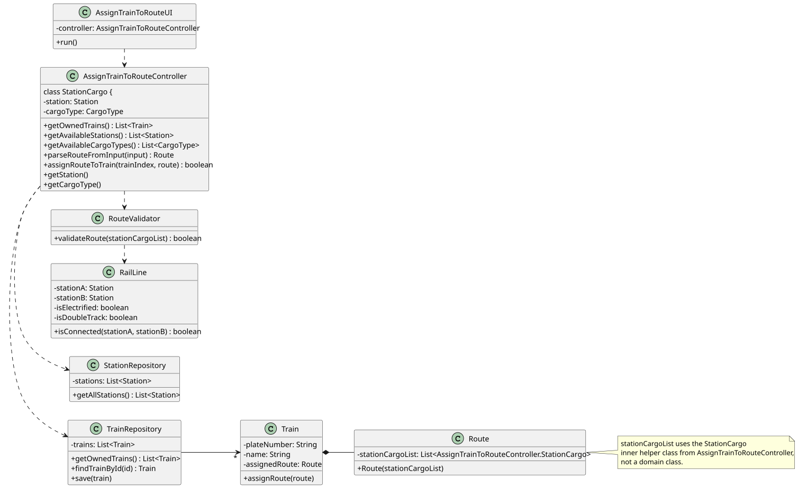

# US010 - Assign a Train to a Route

## 3. Design

### 3.1. Rationale

| Interaction ID | Question: Which class is responsible for...                          | Answer                        | Justification (with patterns)                                                                                  |
|:---------------|:---------------------------------------------------------------------|:------------------------------|:---------------------------------------------------------------------------------------------------------------|
| Step 1         | ... interacting with the actor?                                      | AssignTrainToRouteUI          | Pure Fabrication: no corresponding class in Domain Model; used for user interaction.                           |
|                | ... coordinating the US?                                             | AssignTrainToRouteController  | Controller: manages the overall logic and coordinates the system behavior for this use case.                   |
| Step 2         | ... retrieving owned trains?                                         | TrainRepository               | IE: knows all trains; responsible for fetching them.                                                           |
| Step 3         | ... retrieving available stations and their cargo?                   | StationRepository             | IE: responsible for persisting and retrieving stations and their available cargo.                              |
| Step 4         | ... selecting stations and cargo?                                    | AssignTrainToRouteUI          | IE: UI gathers the player’s choices (route + cargo at each station).                                           |
| Step 5         | ... creating a route?                                                | Route                         | Creator: a Route is a domain entity; builds the route using selected stations and assigned cargo.              |
| Step 6         | ... assigning a route to the selected train?                         | Train                         | IE: Train knows and updates its own route.                                                                     |
| Step 7         | ... validating route connectivity (railway lines between stations)?  | RouteValidator                | IE: Validator knows all existing lines; responsible for checking connectivity.                                 |
| Step 8         | ... persisting changes?                                              | TrainRepository               | IE: repository for persisting updated train state with new route.                                              |
| Step 9         | ... informing operation success?                                     | AssignTrainToRouteUI          | IE: responsible for communicating outcome to the user.                                                         |

### Systematization

**Promoted Domain Classes:**
- Train
- Route
- Station

**Repositories:**
- TrainRepository
- StationRepository

**Pure Fabrication:**
- AssignTrainToRouteUI
- AssignTrainToRouteController
- RouteValidator

## 3.2. Sequence Diagram (SD)

### Full Diagram

This diagram shows the full sequence of interactions between the classes involved in the realization of this user story.

### Split Diagrams

The following diagram shows the same sequence of interactions between the classes involved in the realization of this user story, but it is split in partial diagrams to better illustrate the interactions between the classes.

It uses Interaction Occurrence (a.k.a. Interaction Use).

**Get Task Category List Partial SD**

**Get Task Category Object**

**Get Employee**

**Create Task**

## 3.3. Class Diagram (CD)

