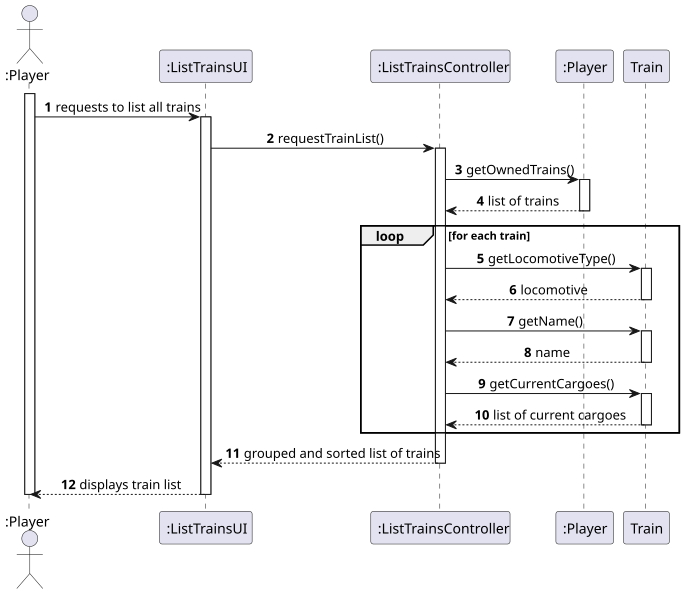
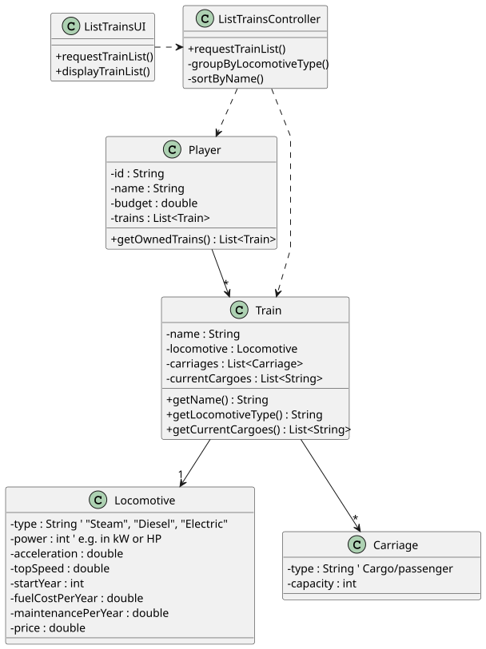

# US011 - List All Trains

## 3. Design

### 3.1. Rationale

| Interaction ID | Question: Which class is responsible for...                        | Answer               | Justification (with patterns)                                                                          |
|----------------|---------------------------------------------------------------------|----------------------|--------------------------------------------------------------------------------------------------------|
| Step 1         | ... interacting with the actor?                                     | ListTrainsUI         | **Pure Fabrication**: UI layer handles user interaction, not part of domain model.                     |
|                | ... coordinating the user story?                                    | ListTrainsController | **Controller**: Coordinates the flow of the use case.                                                  |
| Step 2         | ... knowing the player's owned trains?                              | Player               | **Information Expert**: The Player knows the trains he owns.                                           |
| Step 3         | ... grouping trains by locomotive type?                             | ListTrainsController | **Controller** (with **Low Coupling**): UI delegates data transformation responsibility to Controller. |
|                | ... sorting trains alphabetically by name?                          | ListTrainsController | **Controller**: As above – organizing presentation logic without burdening domain classes.             |
| Step 4         | ... knowing a train’s name, locomotive, and cargoes?                | Train                | **Information Expert**: Each Train knows its own name, assigned locomotive, and current cargoes.       |
| Step 5         | ... knowing the locomotive type of a train?                         | Locomotive           | **Information Expert**: Knows its own type (e.g., steam, electric, diesel).                            |
| Step 6         | ... informing the operation success or displaying the train list?   | ListTrainsUI         | **Pure Fabrication**: Responsible for presenting the data to the user.                                 |

---
### Systematization ##

According to the taken rationale, the conceptual classes promoted to software classes are: 

* Player
* Train

Other software classes (i.e. Pure Fabrication) identified: 

* ListTrainsUI  
* ListTrainsController

## 3.2. Sequence Diagram (SD)

### Full Diagram

This diagram shows the full sequence of interactions between the classes involved in the realization of this user story.

## 3.3. Class Diagram (CD)

