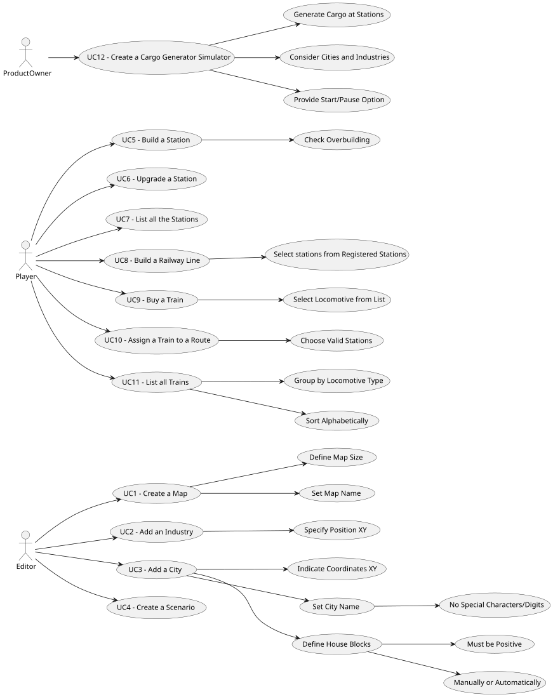

# Use Case Diagram (UCD)

**In the scope of this project, there is a direct relationship of _1 to 1_ between Use Cases (UC) and User Stories (US).**

However, be aware, this is a pedagogical simplification. On further projects and course units there may also exist _1 to N **and/or** N to 1_ relationships between UC and US.

**Insert below the Use Case Diagram in a SVG format**

****

**For each UC/US, it must be provided evidences of applying main activities of the software development process (requirements, analysis, design, tests and code). Gather those evidences on a separate file for each UC/US and set up a link as suggested below.**

# Use Cases / User Stories

| UC/US | Description                                   |                   
|:------|:----------------------------------------------|
| US001 | [Create Map](../../US001/README.md) |
| US002 | [Add Industry](../../US002/README.md) |
| US003 | [Add City](../../US003/README.md) |
| US004 | [Create Scenario](../../US004/README.md) |
| US005 | [Build Station](../../US005/README.md) |
| US006 | [Upgrade Station](../../US006/README.md) |
| US007 | [View Station Details](../../US007/README.md) |
| US008 | [Build Railway Line](../../US008/README.md) |
| US009 | [Buy Train](../../US009/README.md) |
| US010 | [Assign Train to Route](../../US010/README.md) |
| US011 | [List Trains](../../US011/README.md) |
| US012 | [Cargo Generation Simulator](../../US012/README.md) |
