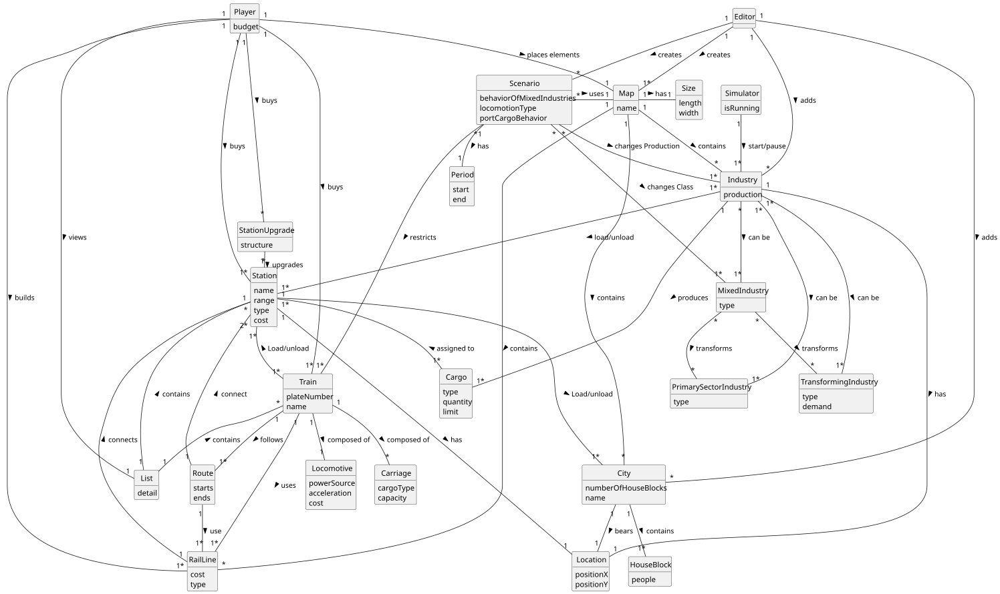

# OO Analysis

The construction process of the domain model is based on the client specifications, especially the nouns (for _concepts_) and verbs (for _relations_) used.

## Rationale to identify domain conceptual classes
To identify domain conceptual classes, start by making a list of candidate conceptual classes inspired by the list of categories suggested in the book "Applying UML and Patterns: An Introduction to Object-Oriented Analysis and Design and Iterative Development".

### _Conceptual Class Category List_

**Business Transactions**

* Player builds Station
* Player builds RailLine
* Player buys Locomotives
* Player buys Station

---

**Transaction Line Items**

* Locomotive Purchase
* RailLine segment built
* Station Purchase 

---

**Product/Service related to a Transaction or Transaction Line Item**

* Locomotive (as product)
* RailLine (as infrastructure service)
* Station (as infrastructure service)

---

**Transaction Records**

* Purchase log (e.g., Locomotives bought by Player, Stations bought by Player)
* Construction log (Stations and RailLines built)

---

**Roles of People or Organizations**

* Player
* Editor
* Simulator (as system role)

---

**Places**

* Map
* City
* Station

---

**Noteworthy Events**

* Scenario definition/change
* Industry production change
* Station upgrade

---

**Physical Objects**

* Station
* Train / Locomotive
* RailLine
* Industry
* House Block

---

**Descriptions of Things**

* Map (Size, Name)
* Station (Name, Building, Upgrades)
* Train (Type, Capabilities, Cost, PlateNumber)
* RailLine (Cost, Type)

---

**Catalogs**

* List of Available Locomotives
* Scenario parameters (e.g., Locomotion Types, Port Behavior)

---

**Containers**

* City (contains House Blocks)
* Map (contains Cities, Industries, RailLines, Stations)

---

**Elements of Containers**

* House Blocks (within City)
* Industries / Cities / Stations (within Map)

---

**Organizations**

* Player’s Railway Company 

---

**Other External/Collaborating Systems**

* Editor (editing tool)

---

**Records of finance, work, contracts, legal matters**

* Player’s budget tracking
* Construction cost records

---

**Financial Instruments**

* Player budget
* Infrastructure investments

---

**Documents mentioned/used to perform some work**

* Scenario definition document
* "Railroad Tycoon II,"Fandom, [Online].Available: https://railroad-tycoon.fandom.com/wiki/Railroad_Tycoon_II. [Accessed: 06-Apr-2025].
* Larman, C. (2004). Applying UML and Patterns (3rd ed.). Prentice Hall. ISBN: 978-0-131-48906-6

## Rationale to identify associations between conceptual classes

An association is a relationship between instances of objects that indicates a relevant connection and that is worth of remembering, or it is derivable from the List of Common Associations:

- **_A_** is physically or logically part of **_B_**
- **_A_** is physically or logically contained in/on **_B_**
- **_A_** is a description for **_B_**
- **_A_** known/logged/recorded/reported/captured in **_B_**
- **_A_** uses or manages or owns **_B_**
- **_A_** is related with a transaction (item) of **_B_**
- etc.

| Concept (A)       |      Association           |                                Concept (B)                                |
|------------------|:--------------------------:|:-------------------------------------------------------------------------:|
| Editor           | create / add               | Map, Industry, City, Scenario                                             |
| Map              | has / contains             | Size, Name, Industry, City, RailLines                                     |
| Industry         | placed                     | Position on Map                                                           |
| Industry         | could be                   | PrimarySectorIndustries, TransformingIndustries, MixedIndustries         |
| Industry         | has                        | Location                                                                  |
| Industry         | load/unload                | Station                                                                   |
| Industry         | produces                   | Cargo                                                                     |
| City             | has / contains             | Name, Location, House Blocks                                              |
| House Blocks     | are assigned               | Manually / Automatically                                                  |
| Scenario         | defines / changes / has    | Port Behavior, Locomotion Types, Industry Generation Factors, MixedIndustries, Industry, Map |
| Scenario         | restricts                  | Trains                                                                    |
| MixedIndustries  | transforms                 | PrimarySectorIndustries, TransformingIndustries                          |
| Player           | build / upgrade / buy      | Map, Station (Depot, Terminal, Station), Railway Line, Trains, Station with Building |
| Player           | choose                     | Railway Line between Two Stations                                         |
| Station          | has / connects / listed    | Name, Existing Building, Upgrades, Demand/Supply of Cargoes, Location, RailLines |
| Station          | upgrade                    | StationUpgrades                                                           |
| Station          | load/unload                | Trains, City                                                              |
| Station          | assigned to                | Cargo                                                                     |
| Trains           | use / follow               | RailLines, Routes                                                         |
| Routes           | use / connect              | RailLines, Stations (2+)                                                  |
| Locomotive       | chosen from                | List of Available Locomotives                                             |
| Product          | generates                  | Cargo at Stations                                                         |
| Simulator        | considers / provides / changes | Cities, Industries, Start/Pause Options                               |

## Domain Model

**Do NOT forget to identify concept atributes too.**

**Insert below the Domain Model Diagram in a SVG format**

